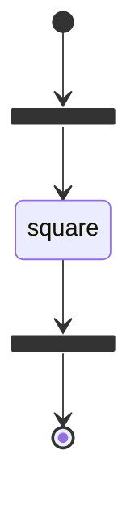

# Pydantic AI 04-03：Pydantic Graph 状态机

> Pydantic Graph 是一个基于 Python type hint 的状态机库：步骤之间怎么连由类型决定，整张图既能运行，也能导出成 mermaid 图。只有当控制流本身就是难点（显式状态、分支、可恢复的转移、并行扇出）时才值得用它，其他情况写普通 Python 就够了。

以 `pydantic-graph 2.64.0` 为准。2.x 起图由 `GraphBuilder` 装配，`graph.run()` 直接返回输出值，`graph.mermaid_code()` 改为 `graph.render()`。

---

## 1. Agent 不够用的时候

`Agent` 内部本身就是一个工具调用循环，简单任务一个 Agent 就够了：

```
user msg ──► [Agent loop: LLM ↔ tool calls] ──► output
```

但有些场景，Agent 内部那个隐式循环撑不住：

- 流程长达十几步，需要明确分成"提取 → 校验 → 入库 → 通知"几段
- 中间需要人工审批，暂停几小时后从断点继续
- 不同步骤要用不同模型（常规步骤用小模型，需要判断的地方用大模型）
- 想画一张图给非技术同事讲清楚整个 pipeline

这时需要一个显式的状态机。Pydantic AI 没有去接 LangGraph，用的是同一团队出的 pydantic-graph。

---

## 2. 设计哲学：节点即类、边即类型

LangGraph 的写法是先建一张空图，再用 `add_node` / `add_edge` 逐条注册。Pydantic Graph 反过来：

```python
class FetchUser(BaseNode[State]):
    async def run(self, ctx: GraphRunContext[State]) -> CheckBalance | End[str]:
        ...
```

返回类型 `CheckBalance | End[str]` 就是这条边。`pydantic-graph` 启动时会扫一遍所有 node 的 return annotation，算出整张图的拓扑。拓扑放进了类型系统，连接写错时 IDE 和 mypy/pyright 会直接报出来。

| 框架 | 节点定义 | 边定义 | 可视化 |
|------|---------|--------|--------|
| LangGraph | `graph.add_node("name", func)` | `graph.add_edge("a", "b")` | LangGraph Studio |
| Pydantic Graph | `class MyNode(BaseNode)` | `run()` 的 return type | `graph.render()` 直接输出 mermaid |

---

## 3. 装配方式：`GraphBuilder`

```python
from pydantic_graph import BaseNode, End, GraphBuilder, GraphRunContext, StepContext
```

`GraphBuilder` 有四个类型参数：`state_type`（共享可变状态）、`deps_type`（依赖）、`input_type`（图的输入）、`output_type`（图的输出）。

### 3.1 State（图的可变状态）

和 Agent 的 `deps` 类似，整张图共享一份 state（通常是 dataclass 或 Pydantic Model）：

```python
from dataclasses import dataclass, field

@dataclass
class State:
    raw: str
    extracted: dict = field(default_factory=dict)
    log: list[str] = field(default_factory=list)
```

### 3.2 写法一：`@g.step` 函数式步骤

```python
@dataclass
class CounterState:
    value: int = 0

async def main():
    g = GraphBuilder(state_type=CounterState, output_type=int)

    @g.step
    async def increment(ctx: StepContext[CounterState, None, None]) -> int:   # StepContext[State, Deps, Inputs]
        ctx.state.value += 1
        return ctx.state.value

    @g.step
    async def double_it(ctx: StepContext[CounterState, None, int]) -> int:
        return ctx.inputs * 2          # ctx.inputs 是上一步的返回值

    g.add(
        g.edge_from(g.start_node).to(increment),
        g.edge_from(increment).to(double_it),
        g.edge_from(double_it).to(g.end_node),
    )

    graph = g.build()
    state = CounterState()
    result = await graph.run(state=state)      # 直接返回输出值：2
```

step 是 `async def`，第一个参数是 `StepContext[State, Deps, Inputs]`（对应 `ctx.state` / `ctx.deps` / `ctx.inputs`）。用 `g.edge_from(a).to(b)` 连边，`g.add(...)` 可以一次登记多条。每张图都有 `g.start_node`（接收初始 `inputs`）和 `g.end_node`（产出最终输出）。

### 3.3 写法二：`BaseNode` 类（边由返回类型决定）

旧的节点类风格仍然支持，边就是 `run()` 的返回类型：

```python
@dataclass
class Extract(BaseNode[State]):
    async def run(self, ctx: GraphRunContext[State]) -> Validate:
        ctx.state.extracted = {"amount": 1280}
        return Validate()                    # ← 返回下一个 node

@dataclass
class Validate(BaseNode[State, None, str]):  # 第三个泛型 = 图的最终输出类型
    async def run(self, ctx: GraphRunContext[State]) -> End[str]:
        return End(f"ok: {ctx.state.extracted}")
```

组装时 builder 需要一个入口 step，把初始输入包成第一个节点，再用 `g.node(...)` 登记每个节点类：

```python
g = GraphBuilder(state_type=State, input_type=str, output_type=str)

@g.step
async def start(ctx: StepContext[State, None, str]) -> Extract:
    return Extract()

g.add(
    g.node(Extract),
    g.node(Validate),
    g.edge_from(g.start_node).to(start),
)
graph = g.build()

state = State(raw="发票：阿里云 ¥1280")
output = await graph.run(state=state, inputs=state.raw)
```

2.x 移除了直接构造 `Graph(nodes=[...])` 和 `graph.run(Extract(), state=...)` 的写法，从旧代码迁移时补上上面的 builder 装配即可。

---

## 4. 完整最小例子：找下一个被 5 整除的数

这个例子来自官方文档，用的是节点类风格加入口 step：

```python
from __future__ import annotations
from dataclasses import dataclass
from pydantic_graph import BaseNode, End, GraphBuilder, GraphRunContext, StepContext

@dataclass
class DivisibleBy5(BaseNode[None, object, int]):     # 泛型：state=None, deps=object(默认), 输出=int
    foo: int

    async def run(self, ctx: GraphRunContext[None]) -> Increment | End[int]:
        if self.foo % 5 == 0:
            return End(self.foo)
        return Increment(self.foo)

@dataclass
class Increment(BaseNode[None]):
    foo: int

    async def run(self, ctx: GraphRunContext[None]) -> DivisibleBy5:
        return DivisibleBy5(self.foo + 1)

g = GraphBuilder(input_type=int, output_type=int)

@g.step
async def start(ctx: StepContext[None, None, int]) -> DivisibleBy5:
    return DivisibleBy5(ctx.inputs)

g.add(g.node(DivisibleBy5), g.node(Increment), g.edge_from(g.start_node).to(start))
fives_graph = g.build()

async def main():
    print(await fives_graph.run(inputs=4))   # 5
```

`Increment` 返回 `DivisibleBy5`，`DivisibleBy5` 又返回 `Increment | End[int]`，循环就是这样形成的。泛型参数是按位置传的，所以要指定输出类型，就得把 deps 那一位写成默认的 `object`。

---

## 5. builder 独有的能力：分支、并行扇出、汇聚

`@g.step` 风格配合 builder，可以声明式地写出条件分支（decision）、并行（map / broadcast）和汇聚（join + reducer），旧的 `BaseNode` 风格做不到这些：

```python
from pydantic_graph import GraphBuilder, StepContext, reduce_list_append

@dataclass
class ProcessingState:
    items_processed: int = 0

g = GraphBuilder(state_type=ProcessingState, input_type=list[int], output_type=list[int])

@g.step
async def square(ctx: StepContext[ProcessingState, None, int]) -> int:
    ctx.state.items_processed += 1
    return ctx.inputs * ctx.inputs

collect = g.join(reduce_list_append, initial_factory=list[int])     # 汇聚：把并行结果收成 list

g.add(
    g.edge_from(g.start_node).map().to(square),        # .map()：把输入 list 的每个元素扇出到一次并行的 square
    g.edge_from(square).to(collect),
    g.edge_from(collect).to(g.end_node),
)
graph = g.build()
print(sorted(await graph.run(state=ProcessingState(), inputs=[1, 2, 3, 4, 5])))   # [1, 4, 9, 16, 25]
```

条件分支用 decision 节点，可以按类型、`Literal` 值或谓词函数匹配，第一个命中的分支生效，和 `if/elif` 一样：

```python
g.add(
    g.edge_from(g.start_node).to(classify),                      # classify 返回 int | str
    g.edge_from(classify).to(
        g.decision()
        .branch(g.match(int).to(handle_int))
        .branch(g.match(str).to(handle_str))
    ),
    g.edge_from(handle_int, handle_str).to(g.end_node),
)
```

其它常用的还有 `.broadcast()`（把同一份数据发给多条并行路径）、内置 reducer（`reduce_list_append` / `reduce_list_extend` / `reduce_dict_update` / `reduce_sum` / `reduce_null` / `ReduceFirstValue`）以及自定义 reducer。

---

## 6. Deps 依赖注入

设计和 `Agent` 完全一样：

```python
@dataclass
class Deps:
    db: DB
    http: httpx.AsyncClient

@dataclass
class Save(BaseNode[State, Deps]):
    async def run(self, ctx: GraphRunContext[State, Deps]) -> End[str]:
        await ctx.deps.db.insert(ctx.state.extracted)
        return End("saved")

g = GraphBuilder(state_type=State, deps_type=Deps, input_type=str, output_type=str)
# ...（登记节点 / 入口 step，同上）...
graph = g.build()
output = await graph.run(
    state=State(raw="..."),
    deps=Deps(db=..., http=...),
    inputs="...",
)
```

好处也一样：写单元测试时换一个假的 `Deps` 就能跑全图。

---

## 7. 节点里调用 Agent

图和 Agent 最常见的组合方式，是在节点内部调用 Agent：

```python
from pydantic_ai import Agent

extract_agent = Agent("openai-chat:qwen-flash", output_type=Invoice)
notify_agent = Agent("openai-chat:qwen-flash", output_type=str)

@dataclass
class Extract(BaseNode[State]):
    async def run(self, ctx: GraphRunContext[State]) -> Validate:
        r = await extract_agent.run(ctx.state.user_input)
        ctx.state.extracted = r.output.model_dump()
        return Validate()
```

不同节点可以用不同的模型（简单步骤用 mini 档，关键判断用旗舰模型），这一点比单个 Agent 灵活。

---

## 8. 导出 Mermaid 可视化

```python
print(graph.render())          # 返回 mermaid stateDiagram-v2 文本（旧名 mermaid_code(start_node=...) 已换成 render()）
```

map + join 那张图的输出：



贴到 https://mermaid.live 就能看。需要给产品同学讲清楚流程时，一条命令就能出图，也适合放进设计文档或 PR 描述。

---

## 9. 逐步执行与持久化

### 9.1 `graph.iter()`：一步一步推进

```python
state = CounterState()
async with graph.iter(state=state) as graph_run:
    async for event in graph_run:
        print(f"{state.value=} | {event=}")       # 每个事件是一批 GraphTask，最后是 EndMarker
        if graph_run.output is not None:
            print("final:", graph_run.output)
            break
```

`GraphRun` 提供 `next_task`（查看下一批要执行的任务）、`output`（完成后的结果）和 `next()`（手动推进，可以注入值）。它适合"在某一步停下来等人工审批"这类控制，不过状态怎么存、存在哪里，需要你自己处理。

### 9.2 持久化

原来的 `pydantic_graph.persistence`（`FileStatePersistence` / `SimpleStatePersistence` / `iter_from_persistence`）在 2.x 里已经移除，`import pydantic_graph.persistence.file` 会报 `ModuleNotFoundError`。要让长流程扛得住重启，现在有这几种做法：

- state 本身是 dataclass 或 Pydantic 模型，自己序列化存起来，恢复时拿存下的 state 重新 `graph.run(state=...)`，从合适的入口继续；
- 用持久执行引擎（Temporal / DBOS / Prefect / Restate…，安装方式见[安装、依赖与环境](../01-basics/02-installation.md)），把整个工作流放进引擎里；
- agent 侧用 harness 的 `StepPersistence`（快照、续跑、分叉）。

---

## 10. vs LangGraph 横向对比

| 维度 | Pydantic Graph | LangGraph |
|------|---------------|-----------|
| 节点定义 | `class Node(BaseNode)` | `def func(state) -> dict` |
| 边定义 | return type 隐式表达 | `add_edge` / `add_conditional_edges` 显式 |
| State 类型 | dataclass / Pydantic Model | `TypedDict` + reducer |
| 并发 | `.map()` / `.broadcast()` + `join` + reducer | `Send` / 并行边 + reducer |
| 持久化 | 自己存 state，或持久执行引擎 | `Checkpointer`（SQLite/Postgres 内置） |
| 可视化 | `graph.render()`（mermaid） | LangGraph Studio / `draw_mermaid` |
| 与 Agent 关系 | 同厂 `pydantic-ai` 无缝 | 同厂 `langchain` 无缝 |
| 生态 | 新，工具少 | 老，模板/例子多 |
| 类型安全 | 完整支持 | TypedDict 部分支持 |

怎么选主要看你已经在用什么：已经用 Pydantic AI、看重类型的，选 Pydantic Graph；已经用 LangChain、需要现成 checkpointer 和中间件的，选 LangGraph。两者都能处理有状态的长流程，技术上没有冲突，差别在和现有生态对齐的成本。

---

## 11. 实战：发票处理工作流

下面是 demo 里的完整流程：

```
[user msg] ──► Extract ──► Validate ─┬─► Save ──► Notify ──► [End]
                              │
                              └─► Reject ──► [End]
```

代码：

```python
@dataclass
class State:
    raw: str
    invoice: Invoice | None = None
    saved_id: int | None = None
    log: list[str] = field(default_factory=list)

@dataclass
class Extract(BaseNode[State]):
    async def run(self, ctx) -> Validate:
        r = await extract_agent.run(ctx.state.raw)
        ctx.state.invoice = r.output
        ctx.state.log.append("extracted")
        return Validate()

@dataclass
class Validate(BaseNode[State]):
    async def run(self, ctx) -> Save | Reject:
        if ctx.state.invoice.amount > 0:
            return Save()
        return Reject(reason="金额非正")

@dataclass
class Save(BaseNode[State]):
    async def run(self, ctx) -> Notify:
        ctx.state.saved_id = 42      # fake DB
        ctx.state.log.append(f"saved id={ctx.state.saved_id}")
        return Notify()

@dataclass
class Notify(BaseNode[State, None, str]):
    async def run(self, ctx) -> End[str]:
        return End(f"已入库 id={ctx.state.saved_id}")

@dataclass
class Reject(BaseNode[State, None, str]):
    reason: str
    async def run(self, ctx) -> End[str]:
        return End(f"拒绝：{self.reason}")

g = GraphBuilder(state_type=State, input_type=str, output_type=str)

@g.step
async def start(ctx: StepContext[State, None, str]) -> Extract:
    return Extract()

g.add(g.node(Extract), g.node(Validate), g.node(Save), g.node(Notify), g.node(Reject),
      g.edge_from(g.start_node).to(start))
graph = g.build()
# output = await graph.run(state=State(raw="..."), inputs="...")
```

`graph.render()` 的输出（节点声明行省略）：入口 step 也是一个节点，`Save | Reject` 这种联合返回会画成一个 choice 节点：

```
[*] --> start
start --> Extract
Extract --> Validate
Validate --> decision
decision --> Reject
decision --> Save
Reject --> [*]
Save --> Notify
Notify --> [*]
```

---

## 12. 何时用 Graph，何时只用 Agent

| 场景 | 用 Agent | 用 Graph |
|------|---------|---------|
| 一问一答、模型自己决定调几次工具 | 适合 | — |
| 步骤明确、人能画出泳道图 | — | 适合 |
| 有"人工审批 / 等回调 / 几小时后继续"的中断 | — | 适合 |
| 不同步骤用不同 model | — | 适合 |
| 想给非技术同事画一张流程图 | — | 适合（mermaid） |
| 想用强类型保证步骤连接 | — | 适合 |
| 一次性脚本、临时业务 | 适合 | — |

实际项目里最常见的是两者一起用：Graph 编排整体流程，node 内部调用 Agent。

---

## 13. 子图与嵌套

可以把一个图当成另一个图的节点，最简单的做法是写一个调用子图的 node：

```python
@dataclass
class RunSubgraph(BaseNode[State]):
    async def run(self, ctx) -> NextNode:
        sub_state = SubState(...)
        sub_output = await sub_graph.run(state=sub_state, inputs=...)
        ctx.state.sub_result = sub_output
        return NextNode()
```

别把所有逻辑塞进一张大图。拆成几个 3-5 个节点的子图，比一张 20 个节点的大图好维护得多。

---

## 14. 常见坑

| 现象 | 原因 | 解决 |
|------|------|------|
| `Node A` 返回 `Node B` 但图里没找到 B | 漏了 `g.node(B)` | 把所有 node 都登记进 builder |
| 类型检查报"return type mismatch" | 节点声明的返回类型和实际不一致 | 改 annotation 或 return |
| 死循环停不下来 | 节点之间没有终止条件（`graph.run()` 没有步数上限参数） | 确保有 `End` 分支；在 state 里计数，超过上限就返回 `End` |
| state 改了但下个节点看不到 | 用了 immutable model + 返回新对象 | 直接 mutate `ctx.state`，pydantic-graph 不会替你做不可变 |
| 并发节点共享 state 写冲突 | `.map()` 出来的多个 step 同时写同一字段 | 用 asyncio Lock、拆字段，或用 reducer 汇聚结果而不是写共享 state |
| `TypeError: Graph.__init__() missing 9 required positional arguments` | 还在用旧的 `Graph(nodes=[...])` | 用 `GraphBuilder` + `g.build()` |
| `AttributeError: 'Graph' has no attribute 'mermaid_code'` | 方法改名 | `graph.render()` |
| `ModuleNotFoundError: pydantic_graph.persistence` | 持久化模块已移除 | 见 §9.2 |
| `result.output` 报错 | `graph.run()` 现在直接返回输出值 | 直接用返回值 |
| Mermaid 里看不到某条边 | 节点 return type 用了 `Any` 或字符串 | 用 `Union` 显式列出所有可能 node 类；`from __future__ import annotations` 下节点类要能被解析 |
| 单元测试不好写 | 直接跑全图很重 | 单独 `await Node().run(ctx)` 测一个 node |
| Logfire 看不到内部步骤 | 没 instrument | `logfire.instrument_pydantic_ai()` 也覆盖 graph 内的 Agent |

---

## 15. 本章 demo

完整可运行代码：[`demos/modules/03_graph.py`](../../demos/modules/03_graph.py)

里面包含：

1. Demo A：发票处理 5 节点工作流（Extract → Validate → Save / Reject → Notify），用 `GraphBuilder` 装配
2. Demo B：`graph.render()` 打印 mermaid 拓扑
3. 没有 API Key 时 Agent 自动回退到 `TestModel`，整张图照样能跑通（占位数据的金额是 0，会走 Reject）

下一篇：[Logfire 可观测性集成](04-logfire.md)，给 Agent、Graph、Tool 全链路加 trace。
