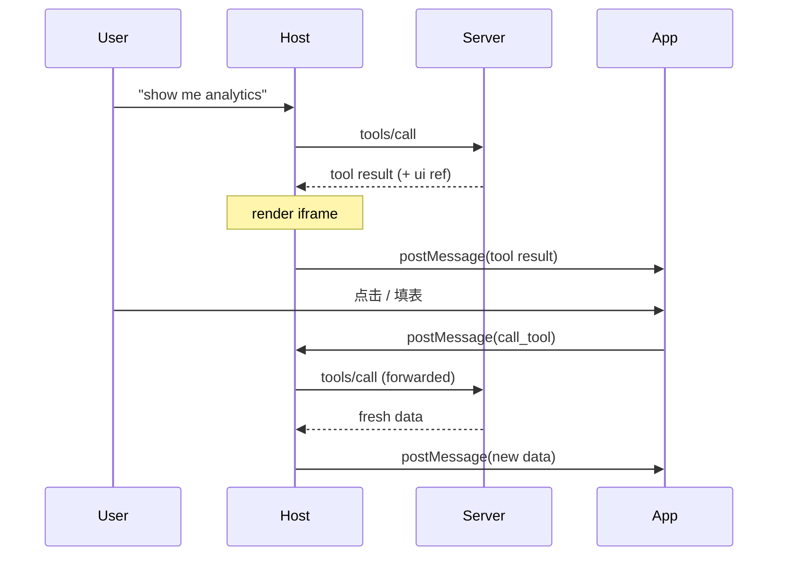

# MCP Advanced 01：用 MCP Apps 在客户端中嵌入交互式 UI

> 有了 MCP Apps，Server 返回的就不只是文字或 JSON，还可以是一个运行在沙盒 iframe 里的完整 HTML 应用：图表可以点，表单可以填，3D 模型可以转。它由两部分组成：一个负责干活、返回数据的工具，和一个 `ui://` 资源（HTML，MIME 类型 `text/html;profile=mcp-app`），工具的 `_meta.ui.resourceUri` 指向这个资源。Python SDK 2.x 内置了 `Apps` 扩展（`mcp.server.apps`），不需要再手写 `_meta`。MCP Apps 是官方扩展（标识符 `io.modelcontextprotocol/ui`），不属于核心规范；Cursor 等 Host 已经支持，具体名单以官方的 Extension Support Matrix 为准。

---

## 1. 为什么需要 MCP Apps

MCP 工具默认返回 text、image 或 structured content，放在对话里阅读没问题，但一涉及交互就很吃力。看销售数据，文字列表远不如一张能点的热力图；配置部署参数，在对话里一问一答远不如一张表单；看 PDF，让模型描述远不如直接嵌一个 PDF 查看器；盯着监控面板，每次都要问一句「现在怎么样」，远不如一个自动刷新的 dashboard。

传统做法是给用户一个 URL，让他跳到别的页面。这样做会离开对话、丢失上下文；数据要双向流动，Server 得自己实现 API 和鉴权；安全要自己保证；同一份 UI 还得适配所有 Host。

MCP Apps 在协议层把这些问题都处理掉了。

---

## 2. 基本流程

```
1. LLM 决定调用一个 Tool
2. Tool 定义的 _meta.ui.resourceUri 指向一个 ui:// 资源
   → Host 提前 fetch 那个 ui:// resource
3. Tool 执行返回结果（content 照样给模型读，同时也是 UI 渲染的数据）
4. Host 在 sandboxed iframe 里加载 HTML
5. Host 通过 postMessage 把 tool result 注入 iframe
6. 用户在 iframe 里交互
7. iframe 用 postMessage 反过来调 MCP Tool（host 转发）
8. Tool 拿到新数据 → 推回 iframe → UI 更新
```



---

## 3. 安全模型

UI 运行在沙盒 iframe 里：不能访问父页面的 DOM，不能读 Host 的 cookie 和 localStorage，不能让父页面跳转，所有通信都走 postMessage（传结构化数据，不能把任意脚本带到父页面的域里执行）。

Host 控制 iframe 能调用哪些工具、能不能打开外部链接。有了这一层，Host 才能放心地渲染第三方 Server 提供的 UI。

---

## 4. Server 端怎么写（Python SDK 的 `Apps`）

```python
from datetime import datetime, timezone

from mcp import Client
from mcp.client import advertise
from mcp.server.apps import APP_MIME_TYPE, EXTENSION_ID, Apps, ResourceCsp, client_supports_apps
from mcp.server.mcpserver import MCPServer
from mcp.server.mcpserver.context import Context

CLOCK_HTML = """\
<!doctype html>
<title>Clock</title>
<h1 id="now">...</h1>
<script>
  const parent = window.parent;
  let initialized = false;
  window.addEventListener("message", (event) => {
    if (event.source !== parent || event.data?.jsonrpc !== "2.0") return;   // 永远校验来源和数据形状
    if (event.data.id === 1 && event.data.result?.protocolVersion) {
      parent.postMessage({jsonrpc: "2.0", method: "ui/notifications/initialized"}, "*");
      initialized = true;
      return;
    }
    if (!initialized || event.data.method !== "ui/notifications/tool-result") return;
    const text = event.data.params?.content?.[0]?.text;
    if (typeof text === "string") document.getElementById("now").textContent = text;
  });
  parent.postMessage({jsonrpc: "2.0", id: 1, method: "ui/initialize",
    params: {appInfo: {name: "clock", version: "1.0.0"}, appCapabilities: {}, protocolVersion: "2026-01-26"}}, "*");
</script>
"""

apps = Apps()


@apps.tool(resource_uri="ui://clock/app.html", description="The current time.")
def get_time(ctx: Context) -> str:
    now = datetime.now(timezone.utc).strftime("%Y-%m-%d %H:%M:%S UTC")
    if not client_supports_apps(ctx):  # 优雅降级：文本客户端和模型只会看到 content，必须是有意义的一句话
        return f"The time is {now}."
    return now


# CSP / 权限放在「资源」上（不是工具上）：这是给 Host 的请求，Host 可以拒绝
apps.add_html_resource("ui://clock/app.html", CLOCK_HTML, title="Clock", csp=ResourceCsp(connect_domains=[]), prefers_border=True)

mcp = MCPServer("clock", extensions=[apps])  # 声明 io.modelcontextprotocol/ui 能力
```

分四步：

- `Apps()`：一个实例，管理你所有带界面的工具及其资源
- `@apps.tool(resource_uri="ui://clock/app.html")`：注册一个普通工具，并自动加上 `_meta.ui.resourceUri`；`@mcp.tool()` 能接受的参数（name、title、description 等）都可以透传
- `apps.add_html_resource(uri, html, title=..., csp=..., permissions=..., prefers_border=...)`：注册配套的资源，以 `text/html;profile=mcp-app` 提供。Host 正是靠这个精确的 MIME 类型判断「这是一个 App，要渲染它」
- `MCPServer("clock", extensions=[apps])`：启用扩展，Server 会在 `capabilities.extensions` 下声明 `io.modelcontextprotocol/ui`

HTML 里监听 Host 发来的 `postMessage`，把结果显示出来。正式的 App 建议在 HTML 里用官方的浏览器端 SDK `@modelcontextprotocol/ext-apps`，它提供 `ontoolresult`、`callServerTool`、`getHostContext`、`onhostcontextchanged`，不用自己处理原始的 message 事件。

### 4.1 优雅降级（规范的硬性要求）

> Tools **MUST** return a meaningful `content` array even when UI is available.

模型读的是 `content`，iframe 是给人看的。支持 UI 的 Host 仍然会把文本结果交给模型，纯文本客户端则只拿得到文本。所以标准写法是一个工具给出两种答案：只有当客户端声明了 `io.modelcontextprotocol/ui` 扩展，并且在 `mimeTypes` 里列出了 `text/html;profile=mcp-app` 时，`client_supports_apps(ctx)` 才返回 `True`（这个字段是必填的，省略了就不算）。不要只返回 `"[Rendered UI]"` 这种占位文字，否则对所有纯文本客户端和模型本身来说，这个工具都没有用。

客户端一侧的协商（Python `Client`）：

```python
from mcp.client import advertise
from mcp.server.apps import APP_MIME_TYPE, EXTENSION_ID

APPS_SUPPORT = advertise(EXTENSION_ID, {"mimeTypes": [APP_MIME_TYPE]})
async with Client(url, extensions=[APPS_SUPPORT]) as client: ...
```

### 4.2 给 iframe 加限制：CSP 和权限设在资源上

```python
from mcp.server.apps import Apps, ResourceCsp, ResourcePermissions

apps.add_html_resource(
    "ui://dashboard/app.html", DASHBOARD_HTML, title="Dashboard",
    csp=ResourceCsp(connect_domains=["https://api.example.com"]),     # connect-src：fetch/XHR 能去哪
    permissions=ResourcePermissions(clipboard_write={}),              # 请求浏览器权限
    domain="dashboard.example.com", prefers_border=True,
)
```

`ResourceCsp` 的字段有：`connect_domains`（对应 `connect-src`）、`resource_domains`（`img-src`、`style-src` 等静态资源）、`frame_domains`（`frame-src`）、`base_uri_domains`（`base-uri`）。`ResourcePermissions` 有 `camera`、`microphone`、`geolocation`、`clipboard_write`。这些只是向 Host 提出的请求，Host 据此构造 iframe 的 CSP 和 Permissions-Policy，也可以拒绝，所以 JS 里要做特性检测。CSP 和权限属于资源，不属于工具：规范在工具的元数据里没有留这个位置，SDK 也从接口上杜绝了这种写法，`@apps.tool()` 没有 `csp` 参数。

### 4.3 可见性

在工具上设置 `visibility=["app"]`，表示这个工具只给 iframe 用，不给模型用。取值有 `"model"`（模型可以调用）、`"app"`（iframe 可以通过 `callServerTool` 调用），省略时两者都可以（默认）。过滤由 Host 负责：你的 Server 照常在 `tools/list` 里列出只给 app 用的工具，由 Host 对模型隐藏，不要在服务端自己过滤。

### 4.4 SDK 在启动时就会拦下的错误

- `resource_uri` 或资源 URI 不是 `ui://...` 开头：装饰或注册时就抛 `ValueError`
- 工具绑定的 URI 没有对应的已注册资源：`MCPServer(extensions=[apps])` 处理扩展时抛 `ValueError`（宣称有一个 HTML，而 `resources/read` 却会 404，这属于配置错误，所以直接拒绝构造）
- 写了 `@apps.tool(meta={"ui": ...})`：抛 `ValueError`。`_meta["ui"]` 由装饰器独占，要用 `resource_uri=` 和 `visibility=` 来表达
- 想用磁盘上的 HTML 文件：`apps.add_resource(FileResource(uri="ui://report/app.html", name="report", path=...))`，SDK 会补上 MIME 类型，显式写错的 MIME 类型会被拒绝
- 面向还在读旧的扁平键 `_meta["ui/resourceUri"]` 的 GA 之前的 Host：自己合并 `meta={"ui/resourceUri": "ui://x"}`（规范的写法是嵌套的 `ui` 对象，扁平键会被淘汰）

自测（`python demos/advanced/01_mcp_app_clock.py`，实际输出）：

```
Server 声明的扩展: ['io.modelcontextprotocol/ui']
tool._meta       : {'ui': {'resourceUri': 'ui://clock/app.html'}}
支持 Apps 的客户端: 2026-11-02 16:48:34 UTC
纯文本客户端     : The time is 2026-11-02 16:48:34 UTC.
UI 资源          : text/html;profile=mcp-app | <title>Clock</title>
```

同一个工具，协商了 Apps 的客户端拿到的是适合在 UI 里渲染的值，纯文本客户端拿到的是一句完整的话。

---

## 5. Client / Host 端要做的事

想让自己写的 Host 支持 MCP Apps，需要：

1. 在能力里声明：`extensions: {"io.modelcontextprotocol/ui": {"mimeTypes": ["text/html;profile=mcp-app"]}}`
2. 拉取 UI 资源：看到工具的 `_meta.ui.resourceUri` 后，用 `resources/read` 读取
3. 用沙盒 iframe 加载 HTML：`<iframe sandbox="allow-scripts">`
4. 搭 postMessage 桥：让 iframe 能反过来调用工具（受 `visibility` 和白名单限制），并把工具结果推送给它（`ui/notifications/tool-result`）
5. CSP 和权限：根据资源上的 `_meta.ui.csp` / `permissions` 构造 iframe 的策略（可以拒绝）
6. 生命周期：工具调用或对话结束时清理 iframe；对模型隐藏 `visibility` 里不含 `"model"` 的工具

可以参考的 SDK：`@modelcontextprotocol/ext-apps` 里的 `AppBridge`（原生 JS）、`@mcp-ui/client`（React）。

---

## 6. 适用与不适用的场景

适合：数据探索（地图、热力图、可以下钻的图表）；有多个选项要配置的场景（部署表单、scenario modeler）；富媒体（PDF、3D、视频、shader、音频）；实时监控（dashboard、日志滚动）；多步审批（报销、PR、issue 分类）。

不适合：只返回一个简短答案的工具（直接返回文本）；需要跨对话长期存在的应用（做成独立的 Web 应用）；高度敏感的操作（iframe 沙盒并不是最终的隔离手段）。

---

## 7. 和 Elicitation 的区别

两者都涉及 UI 交互，但定位完全不同：

| 维度 | Elicitation | MCP Apps |
|------|-------------|----------|
| 主导方 | Server 向用户要信息 | Server 渲染一个应用 |
| UI | 简单表单（由 Host 渲染） | 任意 HTML/JS（由你编写） |
| 触发时机 | 工具执行到一半 | 工具返回时 |
| 复杂度 | 低（声明 schema 即可） | 高（要写前端） |
| 适合 | 确认几个字段 | 完整的可视化界面 |

---

## 8. 工具链与生态

- Server 端：Python SDK 内置了 `mcp.server.apps`；TypeScript 有 `@modelcontextprotocol/ext-apps`；FastMCP 也有自己的 apps 支持
- Client 端：`@mcp-ui/client`（React）、`AppBridge`（原生 JS）
- 示例库：[ext-apps/examples](https://github.com/modelcontextprotocol/ext-apps/tree/main/examples)，有地图、threejs、shadertoy、PDF、音频转写等例子
- Skills：官方提供了 `create-mcp-app` skill（`/plugin marketplace add modelcontextprotocol/ext-apps`），能帮 AI 编程助手搭出一个 MCP App 项目的骨架
- Inspector：新版 Inspector 的 recipes 里有一篇「Reviewing MCP Apps」，可以直接在调试器里审阅 App
- Pydantic AI 的 `MCPToolset` 也支持：带有 `_meta.ui.visibility` 且不含 `"model"` 的工具不会暴露给模型

---

## 9. 设计建议

- UI 资源要小，iframe 加载慢，用户能明显感觉到
- 样式自成一体，不依赖父页面，自带 CSS
- 做响应式布局，iframe 可能很窄
- CSP 只请求确实需要的域名
- 做好降级，`content` 始终要有意义（见 4.1）
- postMessage 双向通信要设防：始终校验 `event.source` 和数据的结构，不要 `eval` 收到的数据
- 不要默认依赖 CDN 脚本，`script-src` 里的外部域名越少越好，能内联或打包就内联

---

## 10. 常见坑

| 坑 | 排查 |
|----|------|
| Host 没有渲染 iframe | 客户端不支持 MCP Apps，查一下官方的 [client matrix](https://modelcontextprotocol.io/extensions/client-matrix) |
| `ValueError: ... no matching registered resource` | 工具的 `resource_uri` 没有配套的 `add_html_resource` / `add_resource` |
| 资源的 MIME 类型写成了 `text/html` | 必须是 `text/html;profile=mcp-app`，否则 Host 不会渲染（`add_html_resource` 会自动设置） |
| 把 `csp` 写在了工具上 | 无效，CSP 和权限属于资源 |
| iframe 加载失败 | CSP 太严，或者外部域名没有写进 `ResourceCsp` |
| iframe 调用不了工具 | postMessage 没实现对，或者 `visibility` 里不含 `"app"`，或者被 Host 的白名单限制了 |
| 工具在纯文本客户端上「没用」 | `content` 里只有占位符，要写一句完整的话 |
| 样式乱掉 | iframe 不会继承父页面的样式，要自带 reset.css |
| 客户端没声明支持就返回了富结果 | 先用 `client_supports_apps(ctx)` 判断，再分开处理 |

---

## 11. 下一步

- Agent Skills 集成：[Agent Skills 与 Skills over MCP](./02-agent-skills.md)
- 发布到 MCP Registry：[把 Server 发布到 MCP Registry](./03-registry.md)
- 实战项目：从[内部知识库 MCP Server](../07-practice/01-project-internal-kb.md)开始

## 参考资料

- MCP Apps 概览：https://modelcontextprotocol.io/extensions/apps/overview
- Build an MCP App：https://modelcontextprotocol.io/extensions/apps/build
- Python SDK MCP Apps：https://py.sdk.modelcontextprotocol.io/advanced/apps/
- Python SDK Extensions：https://py.sdk.modelcontextprotocol.io/advanced/extensions/
- ext-apps 仓库：https://github.com/modelcontextprotocol/ext-apps
- SEP-1865 MCP Apps：https://modelcontextprotocol.io/seps/1865-mcp-apps-interactive-user-interfaces-for-mcp
